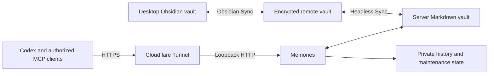

# Architecture and operation

Each Markdown vault is a separate knowledge base. A desktop uses Obsidian desktop Sync; the server uses official Headless Sync and runs Memories against its local copies. Seed each server vault from its authoritative remote vault and verify synchronization in both directions.



Configure a private HTTPS deployment, such as `https://memories.example.com/mcp`, and verify authentication, tool discovery and actual retrieval in each client. The server uses Headless Sync without an Obsidian desktop process. See [Obsidian Headless](https://obsidian.md/help/headless) and [Headless Sync](https://obsidian.md/help/sync/headless).

## Client workflow and tools

For a question involving the owner's life, projects or prior decisions, start with `kb_peek`, search the topic, then fetch the useful notes. Verify facts that may have changed. Save lasting findings and corrections in the relevant notes, retaining sources and uncertainty. The [client skill](../skills/using-memories/SKILL.md) and MCP initialization instructions describe this behavior; the server cannot force every model to retrieve on every turn.

| Tool | Operation |
|---|---|
| `kb_peek(topic?, limit?)` | Relevant snippets, recent notes, folder counts and maintenance summary |
| `search(query, limit?)` | Ranked lexical search across titles, paths, aliases, tags and note text |
| `fetch(id)` | Complete current note, metadata and full-file SHA-256; `id` is the exact relative path, including `.md`, returned by `kb_peek` or `search` |
| `kb_write(path, content, expected_hash?)` | Create or replace Markdown, preserving an existing version |
| `kb_edit(path, find, replace, expected_hash?)` | Replace exactly one raw-text occurrence (case-, accent- and whitespace-sensitive), preserving the rest of the note |
| `kb_remove(path, expected_hash)` | Remove one current note after checking its fetched SHA-256; retain its last content in private history |
| `kb_history(path)` | List previous MCP versions by version, hash and time, without content |
| `kb_restore(path, version, expected_hash?)` | Restore a version, saving current content first; pass the current hash to reject stale restoration or `""` to recreate only a missing note |
| `kb_maintenance()` | Refresh changed-file, duplicate, link and navigation reports |

The `memories://overview` resource provides bounded Markdown navigation. See [ChatGPT setup](chatgpt.md) for the web form and mobile verification, or [agent setup](agents.md) for other harnesses.

Search is case- and accent-insensitive and requires every supplied keyword to match somewhere in a note's searchable fields. Use short topic phrases; try alternate names in separate searches. Results contain bounded snippets; fetch the note before relying on details or editing it. Search reads current files directly and needs no maintenance scan to become fresh.

Optional YAML frontmatter supplies title, tags and aliases. Ordinary Markdown without frontmatter works too. Writes preserve the content supplied by the client without imposing a note template.

`kind`, `status` and `sensitivity` may be useful editorial metadata, but the server
does not validate them or use them to authorize access. See the
[proposed note model](note-model.md) for a small template vocabulary and a
compatible cleanup process. Existing notes and their frontmatter remain readable.

## Configuration and access

| Variable | Purpose | Default |
|---|---|---|
| `MEMORIES_CONFIG` | Private JSON vault registry; see `deploy/vaults.example.json` | Optional; takes precedence over legacy paths/token |
| `MEMORIES_VAULT_ID` | Vault for local stdio or maintenance; unknown IDs fail | `personal` |
| `MEMORIES_VAULT` | Absolute local vault path for legacy single-vault mode | Required without registry |
| `MEMORIES_STATE` | Private state directory outside the vault | `~/.local/state/memories` |
| `MEMORIES_TOKEN` | HTTP bearer credential; runtime requires at least 32 bytes, deployment generates 32 random bytes | Required for HTTP |
| `MEMORIES_PORT` | Loopback HTTP port | `3333` |
| `MEMORIES_CAPABILITY_URL` | Allow a credential-bearing URL for clients without custom headers | `false` |
| `MEMORIES_MAINTENANCE_SECONDS` | HTTP maintenance interval, integer seconds from 10 to 2,147,483 | `900` |

The runtime reads environment variables from its process; it does not load a `.env` file automatically. The systemd deployment uses a private `EnvironmentFile`.

HTTP uses `Authorization: Bearer <token>` at `/mcp`. The listener binds loopback and public access goes through HTTPS. Requests with a browser `Origin` header are rejected. Direct browser JavaScript is not a supported client transport. The HTTP service accepts JSON POST requests with bodies smaller than 3 MiB.

When explicitly enabled, capability mode also accepts `/<token>/mcp`. The entire URL is a credential. Keep it in private client configuration, never in a note, log, screenshot or repository. This service does not implement an OAuth sign-in flow.

Each HTTP credential is bound to exactly one vault. The private registry defines
`id`, absolute `path`, absolute `state`, and `token` for each vault; it must include
`personal`. Tokens must be distinct, URL-safe and at least 32 bytes. Vault and
state directories must not overlap, including through symlink aliases. All nine
tools and resources use the authenticated vault; request parameters cannot change
it. Conflicting URL and bearer credentials are rejected. `kb_peek` reports the
active `vault`. History, locks and maintenance state are separate for each vault.

Legacy environment configuration still serves personal with its existing token.
Rotating one registry token invalidates only clients using it. Stdio access uses
the permissions of the local account that starts the process, so it needs no
bearer header. A cloud service must reach the HTTPS endpoint rather than a local
stdio process. See [project client isolation](agents.md#project-isolation),
including independent connectors and filesystem access.

## Writes, recovery and limits

- Paths are vault-relative and end in `.md`. Hidden paths, traversal, symlinks, non-regular files and notes larger than 2 MiB are rejected.
- Read the note first and pass its SHA-256 as `expected_hash` when updating. An empty hash means create only. A conflict means fetch again and reconcile the change. `kb_edit` also checks the version it read internally.
- Writes use a temporary file and atomic rename. Existing content is saved outside the synced vault before an MCP replacement or restoration.
- Removal requires the exact last-read hash and saves the note before unlinking it. It removes one Markdown file, leaves its directory and history intact, and propagates through Sync. There is no bulk deletion or permanent purge tool. Use `kb_history` followed by `kb_restore(..., expected_hash: "")` to recreate a removed note without overwriting a newly created one.
- Restoration accepts an optional hash for compatibility with existing clients. Pass it on every new restore workflow; omitting it can replace a newer note. The current content is preserved in history first.
- Every MCP writer for a vault on one host must share `MEMORIES_STATE`. Its process-owned lock serializes writes and can recover a dead owner. A live owner is never cleared automatically. An ownerless or unrecognized lock fails after 15 seconds and requires operator inspection.
- External editors and Sync do not acquire that lock. Hash checks detect observed intervening changes, but the final compare and rename are not a transaction shared with those applications. Keep conflict copies and recoverable history.

MCP history covers MCP changes, not every edit by another application. Back up the complete vault and private state independently, retain Obsidian version history, and verify restoration. Sync propagates deletions as well as edits. Runtime state contains previous note content and requires the same privacy as the vault.

## Maintenance

The HTTP process starts its validated listener, then refreshes reports per vault at startup and every 15 minutes by default. A failed scan is reported without stopping healthy vaults; requests that depend on the failing scan still report errors. `pnpm maintenance` or `kb_maintenance` refreshes them on demand. Reports contain changed and deleted paths, exact duplicate groups, broken or ambiguous links, notes without incoming links, and a navigation summary. Each refresh reads the current collection; hashes identify changes between runs.

Maintenance does not merge or delete source notes. An unlinked note is not automatically obsolete, and a broken-link report needs context before repair. The connected AI client can use these reports to consolidate related findings and repair links while preserving sources and unique details. No independent model job or scheduled semantic rewriting is configured; the server does not wake ChatGPT.

Maintenance uses the same validated private state directory as history. Stored
reports and overview files reject symlinks and non-regular files, and each is
limited to 64 MiB. Missing derived state can be regenerated. Corrupt or unsafe
state produces an error; inspect it before replacing it, preserving private note
history separately.

## Verification

From the repository root:

```sh
pnpm test
pnpm typecheck
pnpm build
pnpm test:compiled
```

Tests use temporary vaults. Before activating or upgrading a deployment, also verify unauthenticated denial, authenticated tool discovery, search/fetch, a temporary-note edit, hash-checked removal, restoration after service restart, and synchronization in both directions. The [deployment guide](../deploy/README.md) covers service configuration and recovery.
